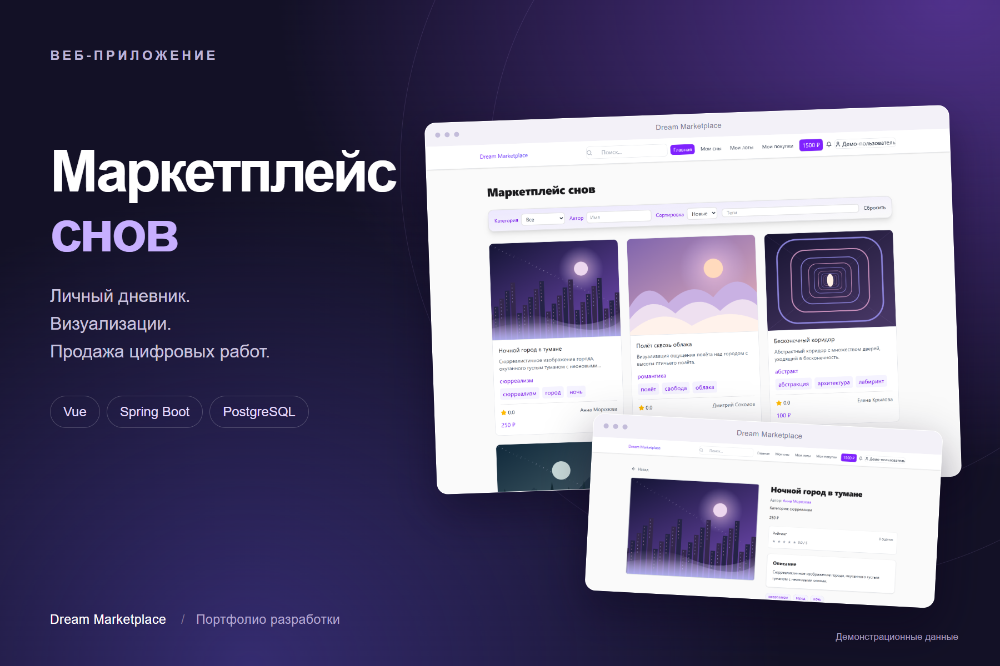
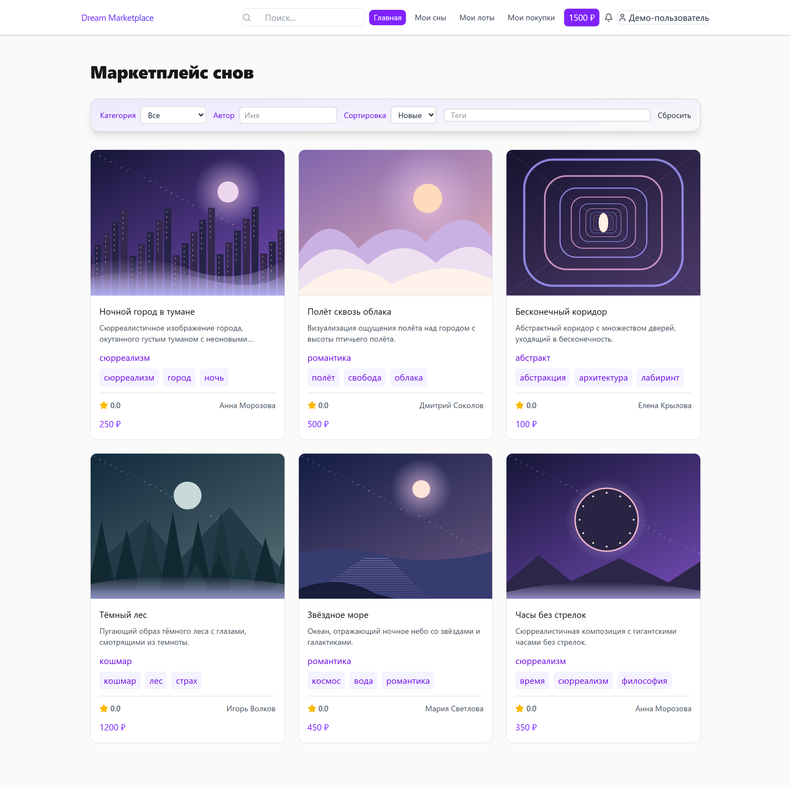
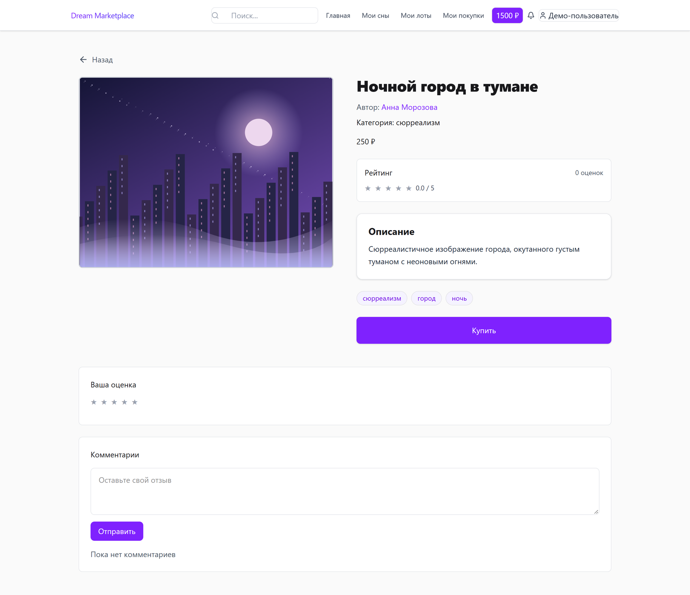
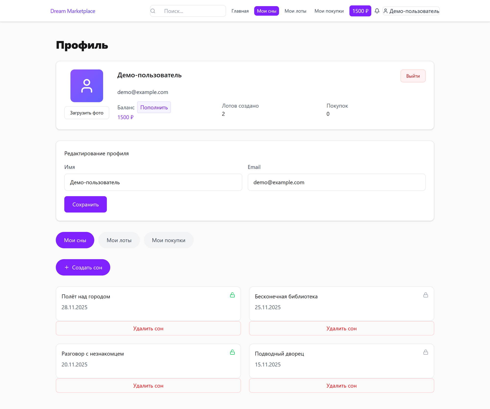
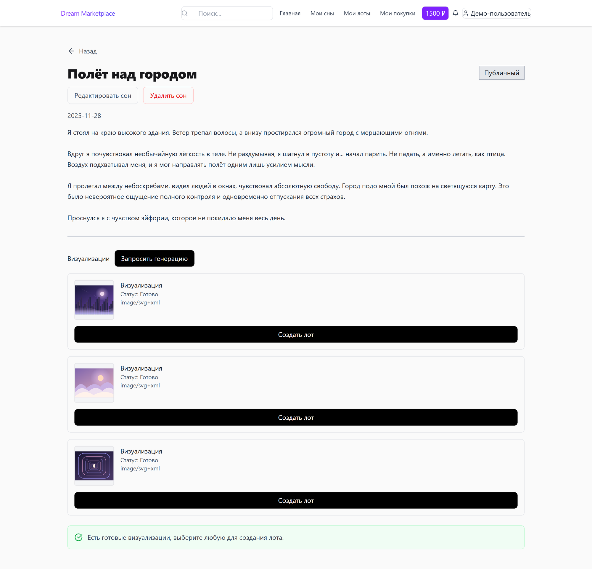
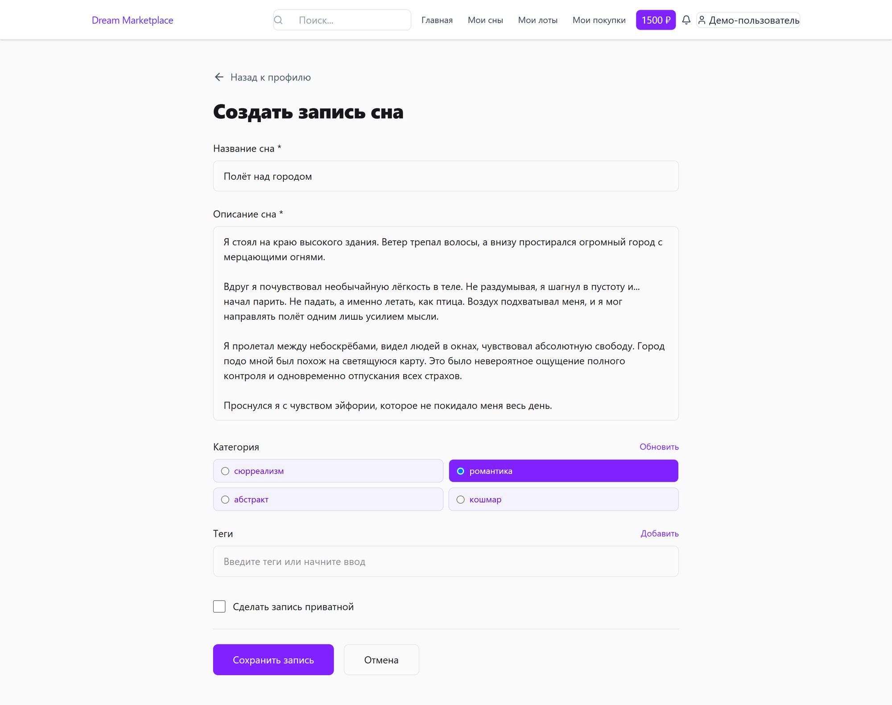
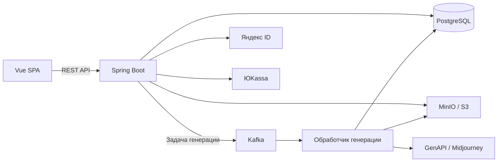

<div align="center">

# Dream Marketplace

**Дневник снов, генерация визуализаций и маркетплейс цифровых работ.**

Java 21 · Spring Boot 4 · Vue 3 · PostgreSQL · Kafka · MinIO

[Интерфейс](#интерфейс) · [Возможности](#возможности) · [Архитектура](#архитектура) · [Локальный запуск](#локальный-запуск)



</div>

Учебный full-stack проект: пользователь записывает сон, запрашивает его визуализацию, выбирает изображение и выставляет его на продажу. Приложение объединяет личный дневник, фоновую обработку задач и торговлю с внутренним балансом.

## Возможности

- **Личный дневник.** Создание и редактирование снов, категории, теги, публичные и приватные записи.
- **Визуализации.** Фоновая генерация изображений через GenAPI, выбор результата и сохранение в S3-совместимое хранилище.
- **Маркетплейс.** Каталог с фильтрами, карточки лотов, покупка с баланса, комиссия платформы и скачивание приобретённого изображения.
- **Профиль и платежи.** Вход через Яндекс ID, редактирование профиля, история покупок и пополнение баланса через ЮKassa в тестовом режиме.
- **Обратная связь и модерация.** Рейтинги, комментарии, уведомления и административная проверка лотов.

## Интерфейс

Скриншоты показывают интерфейс с демонстрационными данными и иллюстрациями. Нажмите на изображение, чтобы рассмотреть его в полном размере.

### Каталог

[](docs/images/showcase/catalog.webp)

| Карточка лота | Личный кабинет |
| :---: | :---: |
| [](docs/images/showcase/lot-detail.webp) | [](docs/images/showcase/profile.webp) |

| Сон и визуализации | Создание записи |
| :---: | :---: |
| [](docs/images/showcase/dream-visualizations.webp) | [](docs/images/showcase/create-dream.webp) |

## Технологии

| Часть системы | Стек |
| --- | --- |
| Backend | Java 21, Spring Boot 4.0, Spring Web MVC, Spring Security, Spring Data JPA, Lombok, Gradle |
| Frontend | Vue 3, Vue Router, Vite, Tailwind CSS, Lucide |
| Данные | PostgreSQL 15, Flyway, MinIO / S3 |
| Фоновая обработка | Apache Kafka, Spring Kafka |
| Интеграции | Яндекс ID / OAuth 2.0, JWT, GenAPI / Midjourney, ЮKassa |
| Локальное окружение | Docker Compose |

## Архитектура

Backend — Spring Boot монолит с REST API. Контроллеры принимают запросы, сервисы выполняют прикладные сценарии, репозитории работают с PostgreSQL. API использует DTO; схему базы данных версионирует Flyway.



Генерация выполняется в фоне: API создаёт задачу и отправляет сообщение в Kafka. Обработчик обращается к GenAPI, сохраняет изображения в MinIO и обновляет статус задачи. Пользователь выбирает готовый результат и создаёт лот.

При покупке сервис проверяет доступность лота и баланс, записывает транзакцию, распределяет сумму между продавцом и платформой и переводит лот в статус проданного.

### Где смотреть реализацию

| Сценарий | Код |
| --- | --- |
| Покупка лота и комиссия | [PurchaseService](backend/src/main/java/ru/urasha/callmeani/dream_marketplace/service/PurchaseService.java) |
| Фоновая генерация | [ImageGenerationWorker](backend/src/main/java/ru/urasha/callmeani/dream_marketplace/service/ImageGenerationWorker.java) |
| Пополнение баланса | [PaymentService](backend/src/main/java/ru/urasha/callmeani/dream_marketplace/service/PaymentService.java) |
| Модерация | [ModerationService](backend/src/main/java/ru/urasha/callmeani/dream_marketplace/service/ModerationService.java) |
| Миграции PostgreSQL | [db/migration](backend/src/main/resources/db/migration) |
| Клиентские страницы | [frontend/src/components/pages](frontend/src/components/pages) |

## Локальный запуск

Нужны **JDK 21**, **Node.js 22.12+**, npm и Docker с Compose. Gradle запускается через wrapper из репозитория.

<details>
<summary><strong>Настройка окружения и команды запуска</strong></summary>

```bash
git clone https://github.com/urasha/dream-marketplace.git
cd dream-marketplace
```

Создайте `backend/.env` с настройками для локальной инфраструктуры и используемых интеграций:

| Переменные | Назначение |
| --- | --- |
| `DB_USER`, `DB_PASSWORD` | Учётные данные PostgreSQL для Compose и backend |
| `S3_ACCESS_KEY`, `S3_SECRET_KEY`, `S3_BUCKET` | Учётные данные и бакет MinIO |
| `JWT_SECRET` | Секрет подписи JWT |
| `YANDEX_CLIENT_ID`, `YANDEX_CLIENT_SECRET` | Приложение Яндекс ID |
| `GENAPI_API_KEY` | Доступ к генерации изображений |
| `YOOKASSA_SHOP_ID`, `YOOKASSA_SECRET_KEY` | Тестовый магазин ЮKassa |

Полная конфигурация и значения по умолчанию — в [application.yml](backend/src/main/resources/application.yml). `.env` исключён из Git. Для полного пользовательского сценария нужны настроенные внешние интеграции. Callback Яндекс ID по умолчанию: `http://localhost:8080/oauth/yandex/callback`.

**Инфраструктура и backend:**

```bash
cd backend
docker compose up -d
./gradlew bootRun
```

В Windows PowerShell вместо `./gradlew bootRun` используйте `.\gradlew.bat bootRun`.

Compose запускает PostgreSQL, Kafka с ZooKeeper и MinIO, создаёт бакет и применяет миграции через Flyway. Backend запускается отдельно.

**Frontend** — в другом терминале, из корня репозитория:

```bash
cd frontend
npm ci
npm run dev
```

| Сервис | Адрес |
| --- | --- |
| Веб-интерфейс | [localhost:5173](http://localhost:5173) |
| Backend API | [localhost:8080](http://localhost:8080) |
| Swagger UI | [localhost:8080/swagger-ui/index.html](http://localhost:8080/swagger-ui/index.html) |
| Консоль MinIO | [localhost:9001](http://localhost:9001) |

Frontend по умолчанию обращается к `http://localhost:8080`. Другой адрес можно задать через `VITE_API_URL` в `frontend/.env.local`.

</details>

## Структура репозитория

```text
backend/      Spring Boot API, фоновые обработчики, миграции и Docker Compose
frontend/     Vue SPA: страницы, компоненты, состояние и API-клиенты
docs/         Требования, проектирование базы данных и отчёт на Typst
```

Документация: [требования и сценарии](docs/first-stage.typ) · [проектирование БД](docs/second-stage.typ) · [описание реализации](docs/third-stage.typ) · [OpenAPI](backend/src/main/resources/static/openapi.yaml).

Лицензия — [MIT](LICENSE).
